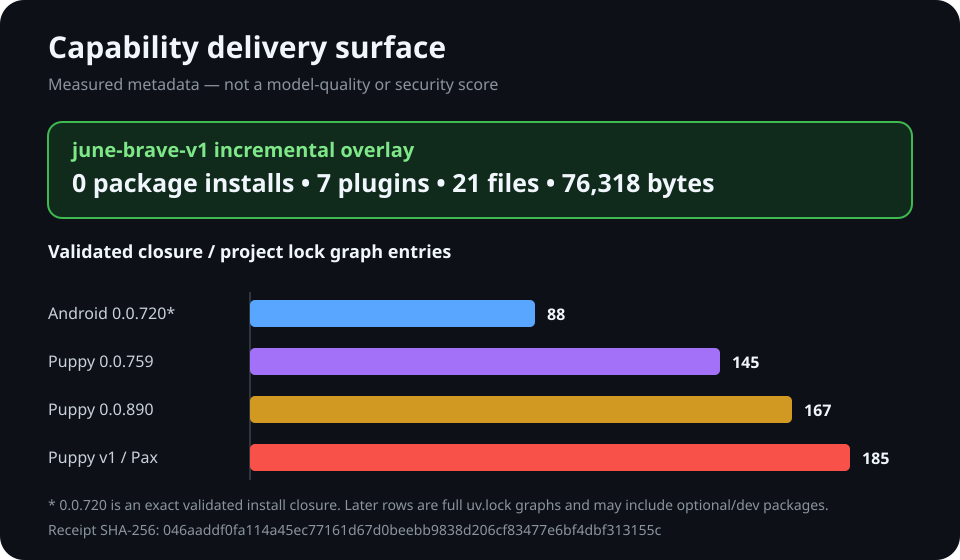

# DroidPuppy Delivery-Surface Benchmark



## Headline

> **The protected June Android capability layer adds zero packages: seven
> bounded plugins, 21 files, and 76,318 bytes.**

That is the measured incremental delivery cost of `june-brave-v1` when layered
onto an existing working Code Puppy engine. It is the concrete expression of the
Platform Substitution Thesis:

```text
Framework expansion
new capability -> more framework dependencies -> larger environment

Platform substitution
new requirement -> existing native capability -> bounded adapter
```

## Measured results

| Target | Measurement | Sensitive families observed |
|---|---:|---|
| `june-brave-v1` | **0 package installs**, 7 plugins, 21 files, 76,318 bytes | Explicitly forbids Pax, harness, Monty, Playwright, Tree-sitter |
| Android `0.0.720` recovery | 88 exact pins in validated install closure | None of the five benchmark-sensitive families |
| Code Puppy `0.0.759` | 145 entries in project lock graph | Harness; Playwright in lock |
| Code Puppy `0.0.890` | 167 entries in project lock graph | Harness, Monty, Playwright, Tree-sitter |
| Code Puppy `1.0.0rc1`/Pax | 185 entries, 5 Git sources | Pax, harness, Monty; 9 requested Pax extras |

## The important boundary

These rows are not pretending to be one interchangeable metric:

- `june-brave-v1` measures **incremental overlay delivery**. It requires an
  existing working engine and therefore does not represent a standalone agent.
- Android `0.0.720` is an **exact validated installation closure** captured from
  a known-good Termux environment.
- The later Puppy rows count **all entries in each project's `uv.lock`**. Lock
  graphs can include optional and development packages that a default install
  may not install.

Therefore the benchmark does **not** claim that a default v1 install necessarily
installs all 185 lock entries, or that zero overlay packages means a zero-package
agent. It demonstrates a narrower result:

> The original Android capability was delivered without expanding the working
> engine's package environment, while later project generations described
> progressively larger framework and lock surfaces.

That result is still useful because delivery surface affects qualification,
provenance, compatibility, audit effort, and recovery—even when not every locked
package is installed in one profile.

## Why the six-dependency v1 headline is deceptive

The v1 project declares only six direct dependencies, but one is Pax with nine
requested extras:

```text
boxd, daytona, e2b, kubernetes, modal,
opensandbox, render, sprites, typesafe
```

Its lock graph contains 185 packages and five Git sources pinned to an upstream
Pydantic AI commit. Direct-dependency count alone therefore hides meaningful
delivery complexity.

## Reproduce it

The benchmark is stdlib-only and performs no package installation, network
request, provider request, or target mutation:

```bash
python scripts/benchmark_delivery.py \
  --target june-brave-v1=baselines/june-brave-v1.json \
  --target android-0720=constraints/android-0720.txt \
  --target puppy-0759=/path/to/0.0.759/pyproject.toml \
  --target puppy-0890=/path/to/0.0.890/pyproject.toml \
  --target puppy-v1=/path/to/v1/pyproject.toml \
  --output delivery-surface.json
```

Published receipt:

```text
evidence/benchmarks/delivery-surface-local-20261122.json
```

Receipt SHA-256:

```text
046aaddf0fa114a45ec77161d67d0beebb9838d206cf83477e6bf4dbf313155c
```

Every input is identified by SHA-256 in the receipt. Labels are for humans;
hashes are the evidence boundary.

## What this does not prove

Phase 1 does not establish:

- model intelligence or coding quality;
- task completion rate;
- token efficiency;
- latency or memory superiority;
- exploitable vulnerability count;
- security or resistance to compromise;
- capability parity between the compared systems.

Those questions belong to the documented next phases: isolated startup,
same-model capability tasks, transport-level token/request accounting, and
authority/recovery tests.

## Shareable summary

> We benchmarked how DroidPuppy's original Android capability was delivered—not
> which model is smartest. The protected June baseline adds zero packages: seven
> Android-native plugins, 21 files, and 76 KB, reusing a working engine and
> native Brave instead of reproducing Playwright/Chromium on the phone. For
> context, our validated Android 0.0.720 recovery closure has 88 exact pins,
> while later Puppy lock graphs contain 145, 167, and 185 entries. The receipt,
> input hashes, verifier, tests, methodology, and limitations are public.
